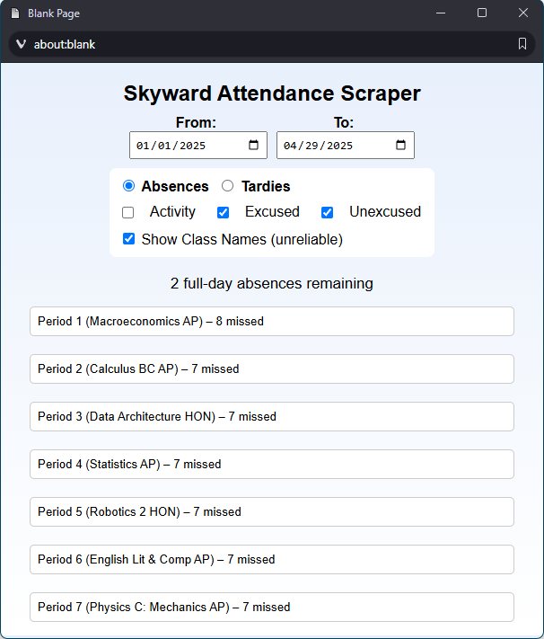

# Skyward Absence Scraper

> [!NOTE]
> **Updated November 2, 2026:** Skyward changed its page addresses, which broke the bookmarklet. It's fixed now, and if you already have the bookmark you don't need to change anything. Results now open in a window on top of the Skyward page instead of a separate popup (so you no longer need to allow popups), and it works on phones too. The screenshot and videos below show the older version, but the steps for creating and using the bookmarklet haven't changed, so they're still accurate.
 
<span style="font-size: 50px;">[CLICK HERE TO JUMP TO INSTRUCTIONS/TUTORIALS](#creating-and-using-the-bookmarklet)</span>




This bookmarklet provides insight into your past attendance by extracting Skyward's logs directly from the webpage and categorizing them. It supports filtering by type of entry as well as date range. This bookmarklet is intended for AHS (American Heritage School) students.


## Contents:
  - [Demo](#demo)
  - [Features](#features)
  - [Disclaimers](#disclaimers)
  - [Creating and using the bookmarklet](#creating-and-using-the-bookmarklet)
  - [Credits](#credits)


## Demo: 
https://github.com/user-attachments/assets/1b4223d9-aa73-44a5-b56d-98f192dabf5c


## Features:
 - Intuitive and Skyward-esque GUI
 - No extension required
 - Date range filter (automatically filters by last semester with start date defaulting to the closest 6 month mark)
 - View absences and tardies separately (as of May 2025, at AHS Broward, exemptions are only nullified if you are over 10 absences OR over 10 tardies for a class)
 - Filter absences by activity absences, excused absences, and unexcused absences
 - Filter tardies by excused tardies and unexcused tardies
 - Dropdowns for each period showing total count and relevant entry dates
 - Countdown for full-day absences remaining when viewing excused + unexcused absences (types counting towards exemptions, 10 absences max)
 - Display class names next to period number
 - Works on phones, tablets, and computers
 - Supports parent accounts with multiple students


## Disclaimers:
 - This only works if each attendance entry is labelled correctly. Any entry with the word "Tardy" in it is a tardy. Otherwise, it is assumed that any entry with "Unexcused" in it is an unexcused absence, else any entry with "Activity" or "Exempt" in it is an activity absence, else any entry with "Excused" in it is an excused absence, finally falling back into "Unexcused" if none of the criteria are met.


## Creating and using the bookmarklet:
### Creating:
 1. Copy the following code into your clipboard:
 ```js
javascript: fetch("https://raw.githubusercontent.com/victorbjafet/absences/refs/heads/main/content.js").then(r => r.text()).then(r => eval(r))
 ```
 2. Right click on your bookmarks bar and click "add page."
 3. Set the name of the bookmark to whatever you want.
 4. Paste in the code into the box for the url and save the bookmark.


### Using:
 1. Log into Classlink and Skyward.
 2. Navigate to the attendance tab in your Skyward.
 3. Click on the bookmarklet to run the script. The results open on top of the Skyward page; click the × (or press Escape) to close them.


### Computer tutorial:
https://github.com/user-attachments/assets/1b788057-cdb0-4e08-9615-975944a6644d


### iPad (Chrome app) tutorial:
https://github.com/user-attachments/assets/6c0605d3-6c90-40a1-be35-6f4a8ed8dee1

Note 1: this also works in the iPhone Chrome app. To run a bookmarklet there, type the bookmark's name into the address bar and tap it in the suggestions.

Note 2: you can also use this bookmarklet in Safari.


## Credits:
All code created by [me](https://github.com/victorbjafet) almost exclusively using GPT 4o and GPT 4o-mini-high.

Updated in November 2026 (Skyward address fix, phone support, and UI improvements) using Claude Opus 5.5.

Readme based off [edpuzzle-answers](https://github.com/ading2210/edpuzzle-answers/blob/main/README.md).
